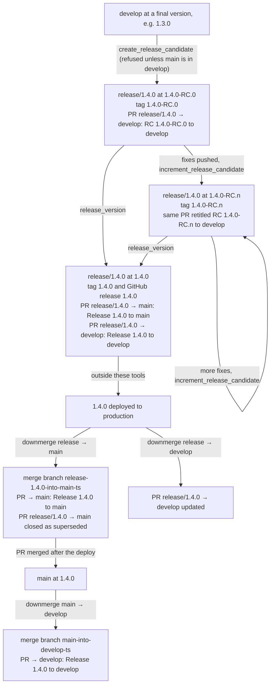
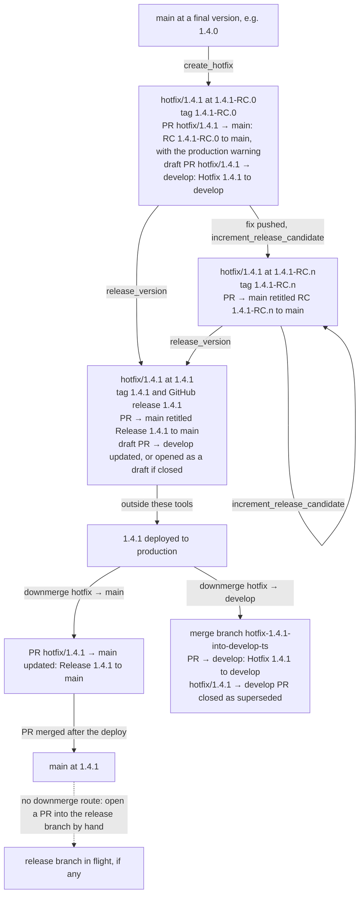
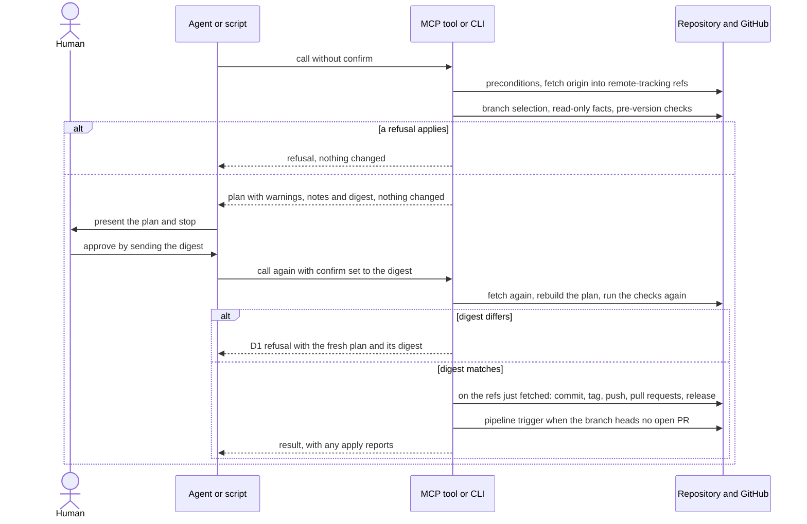
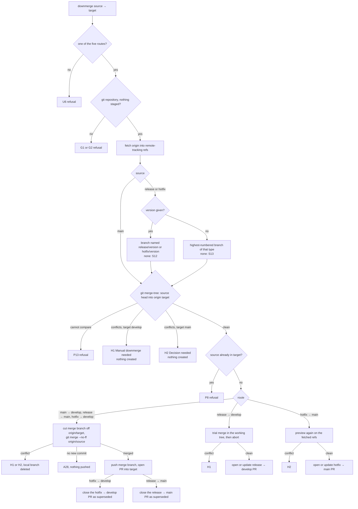
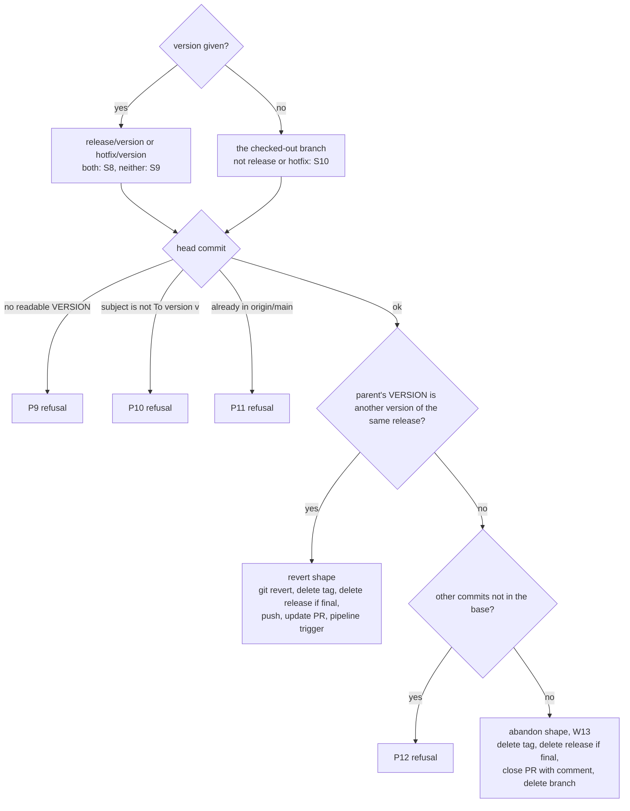
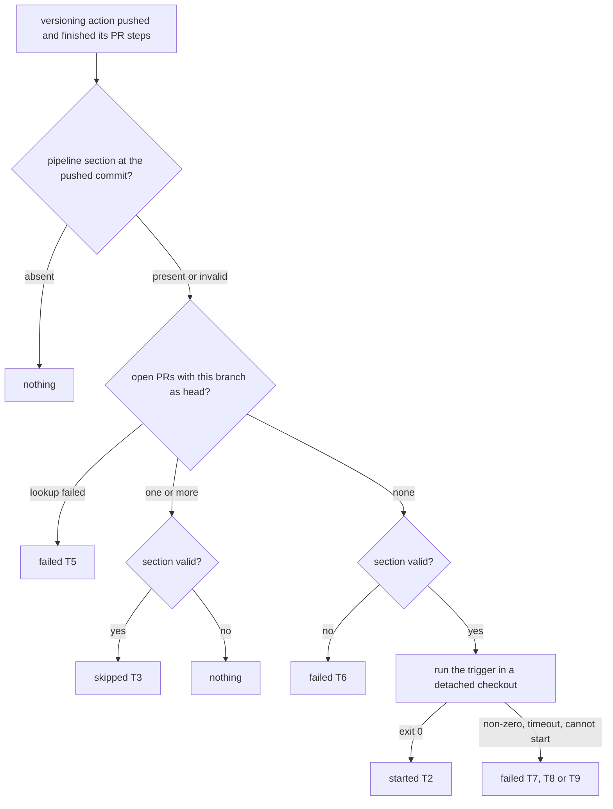

# Flows

Diagrams of the release lifecycle, the hotfix lifecycle, the plan/confirm protocol, the
downmerge decisions, the revert shape and the pipeline trigger. They summarise
[actions.md](actions.md), which is authoritative on detail; message IDs refer to
[messages.md](messages.md). GitHub renders the Mermaid blocks.

Deploying to production is not an action of these tools. It appears in the diagrams
because several steps must wait for it.

## Release lifecycle

Each RC can be undone with `revert_version` (RC.n back to RC.n-1, a final back to its RC,
RC.0 abandons the branch); see [Revert shape](#revert-shape). `release_version` warns when
`main` holds commits the branch lacks or would conflict with it (W3, W4), and
`increment_release_candidate` and `release_version` warn when a shipped hotfix is missing
from the release branch (W1).

## Hotfix lifecycle

Once the hotfix is in `main`, `create_release_candidate`, `increment_release_candidate` and
`release_version` warn (W1) until it is also in `develop` or the release branch. There is
no downmerge route into a release branch.

## Plan and confirm

The CLI's `--yes` skips the human step: it builds the plan, prints it to stderr, and
applies. `downmerge` and `initialize_versioner` never return a plan. What the digest covers
is in [actions.md](actions.md#what-the-digest-covers).

## Downmerge

## Revert shape

## Pipeline trigger

